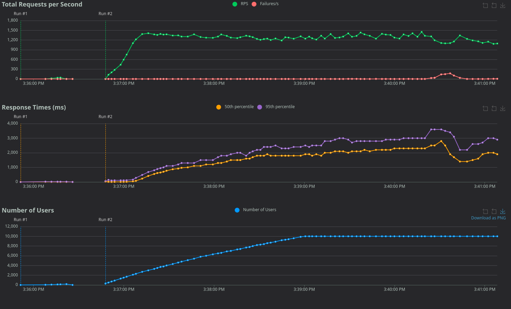
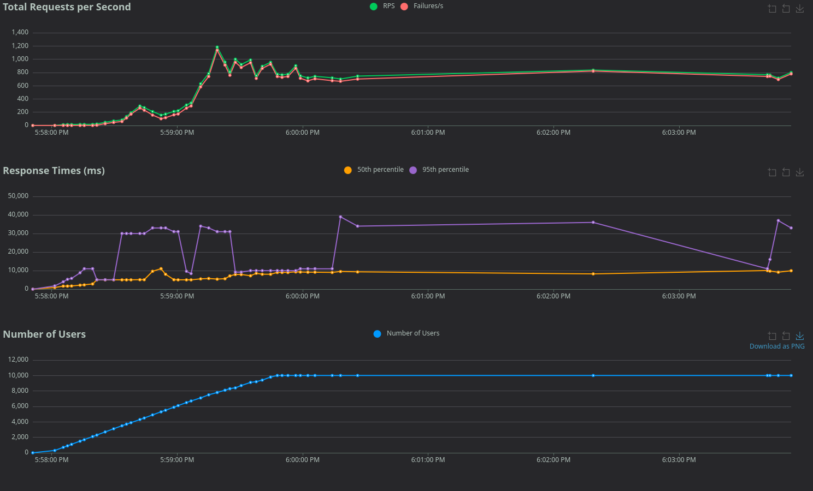

Sans Autoscaling :
```bash
kubectl logs -l app=base-converter --prefix -f
```

[pod/base-converter-deployment-7678d4fb47-zjdjc/base-converter] 2026-10-13T12:55:03.583Z GET /ready
[pod/base-converter-deployment-7678d4fb47-zpxq7/base-converter] 2026-10-13T12:55:06.631Z GET /ready
[pod/base-converter-deployment-7678d4fb47-zjdjc/base-converter] 2026-10-13T12:55:08.464Z GET /live
[pod/base-converter-deployment-7678d4fb47-zjdjc/base-converter] 2026-10-13T12:55:08.582Z GET /ready
[pod/base-converter-deployment-7678d4fb47-zpxq7/base-converter] 2026-10-13T12:55:11.621Z GET /ready
[pod/base-converter-deployment-7678d4fb47-zjdjc/base-converter] 2026-10-13T12:55:13.583Z GET /ready
[pod/base-converter-deployment-7678d4fb47-zpxq7/base-converter] 2026-10-13T12:55:16.621Z GET /ready




# Avec Autoscaling : 
```bash
kubectl logs -l app=base-converter --prefix 
```
[pod/base-converter-deployment-d7676b595-zmj59/base-converter] Converter running on http://localhost:3000
[pod/base-converter-deployment-d7676b595-5qd7z/base-converter] 2026-10-13T15:02:05.407Z GET /heavy
[pod/base-converter-deployment-d7676b595-5qd7z/base-converter] 2026-10-13T15:02:05.687Z GET /heavy
[pod/base-converter-deployment-d7676b595-5qd7z/base-converter] 2026-10-13T15:02:05.957Z GET /heavy
[pod/base-converter-deployment-d7676b595-5qd7z/base-converter] 2026-10-13T15:02:06.603Z GET /heavy
[pod/base-converter-deployment-d7676b595-5qd7z/base-converter] 2026-10-13T15:02:06.902Z GET /heavy
[pod/base-converter-deployment-d7676b595-5qd7z/base-converter] 2026-10-13T15:02:07.619Z GET /heavy
[pod/base-converter-deployment-d7676b595-5qd7z/base-converter] 2026-10-13T15:02:07.931Z GET /heavy
[pod/base-converter-deployment-d7676b595-5qd7z/base-converter] 2026-10-13T15:02:08.204Z GET /heavy
[pod/base-converter-deployment-d7676b595-5qd7z/base-converter] 2026-10-13T15:02:09.493Z GET /heavy
[pod/base-converter-deployment-d7676b595-5qd7z/base-converter] 2026-10-13T15:02:09.696Z GET /heavy
[pod/base-converter-deployment-d7676b595-8dhmf/base-converter] 2026-10-13T15:02:05.015Z GET /heavy
[pod/base-converter-deployment-d7676b595-8dhmf/base-converter] 2026-10-13T15:02:05.237Z GET /heavy
[pod/base-converter-deployment-d7676b595-8dhmf/base-converter] 2026-10-13T15:02:05.748Z GET /heavy
[pod/base-converter-deployment-d7676b595-8dhmf/base-converter] 2026-10-13T15:02:06.030Z GET /heavy
[pod/base-converter-deployment-d7676b595-8dhmf/base-converter] 2026-10-13T15:02:06.831Z GET /heavy
[pod/base-converter-deployment-d7676b595-8dhmf/base-converter] 2026-10-13T15:02:07.317Z GET /heavy
[pod/base-converter-deployment-d7676b595-8dhmf/base-converter] 2026-10-13T15:02:08.299Z GET /heavy
[pod/base-converter-deployment-d7676b595-8dhmf/base-converter] 2026-10-13T15:02:08.524Z GET /heavy
[pod/base-converter-deployment-d7676b595-8dhmf/base-converter] 2026-10-13T15:02:09.234Z GET /heavy
[pod/base-converter-deployment-d7676b595-8dhmf/base-converter] 2026-10-13T15:02:09.509Z GET /heavy
[pod/base-converter-deployment-d7676b595-bvqhq/base-converter] 2026-10-13T15:02:05.493Z GET /heavy
[pod/base-converter-deployment-d7676b595-bvqhq/base-converter] 2026-10-13T15:02:06.007Z GET /heavy
[pod/base-converter-deployment-d7676b595-bvqhq/base-converter] 2026-10-13T15:02:06.346Z GET /heavy
[pod/base-converter-deployment-d7676b595-bvqhq/base-converter] 2026-10-13T15:02:07.089Z GET /heavy
[pod/base-converter-deployment-d7676b595-bvqhq/base-converter] 2026-10-13T15:02:07.864Z GET /heavy
[pod/base-converter-deployment-d7676b595-bvqhq/base-converter] 2026-10-13T15:02:08.301Z GET /heavy
[pod/base-converter-deployment-d7676b595-bvqhq/base-converter] 2026-10-13T15:02:08.563Z GET /heavy
[pod/base-converter-deployment-d7676b595-bvqhq/base-converter] 2026-10-13T15:02:08.844Z GET /heavy
[pod/base-converter-deployment-d7676b595-bvqhq/base-converter] 2026-10-13T15:02:09.054Z GET /heavy
[pod/base-converter-deployment-d7676b595-bvqhq/base-converter] 2026-10-13T15:02:09.847Z GET /heavy
[pod/base-converter-deployment-d7676b595-c7zg7/base-converter] 2026-10-13T15:02:05.976Z GET /heavy
[pod/base-converter-deployment-d7676b595-c7zg7/base-converter] 2026-10-13T15:02:06.237Z GET /heavy
[pod/base-converter-deployment-d7676b595-c7zg7/base-converter] 2026-10-13T15:02:06.505Z GET /heavy
[pod/base-converter-deployment-d7676b595-c7zg7/base-converter] 2026-10-13T15:02:07.230Z GET /heavy
[pod/base-converter-deployment-d7676b595-c7zg7/base-converter] 2026-10-13T15:02:07.518Z GET /heavy
[pod/base-converter-deployment-d7676b595-c7zg7/base-converter] 2026-10-13T15:02:07.790Z GET /heavy
[pod/base-converter-deployment-d7676b595-c7zg7/base-converter] 2026-10-13T15:02:08.238Z GET /heavy
[pod/base-converter-deployment-d7676b595-c7zg7/base-converter] 2026-10-13T15:02:09.227Z GET /heavy
[pod/base-converter-deployment-d7676b595-c7zg7/base-converter] 2026-10-13T15:02:09.503Z GET /heavy
[pod/base-converter-deployment-d7676b595-c7zg7/base-converter] 2026-10-13T15:02:09.760Z GET /heavy
[pod/base-converter-deployment-d7676b595-fgtb8/base-converter] 2026-10-13T15:02:06.679Z GET /heavy
[pod/base-converter-deployment-d7676b595-fgtb8/base-converter] 2026-10-13T15:02:06.913Z GET /heavy
[pod/base-converter-deployment-d7676b595-fgtb8/base-converter] 2026-10-13T15:02:07.197Z GET /heavy
[pod/base-converter-deployment-d7676b595-fgtb8/base-converter] 2026-10-13T15:02:07.395Z GET /heavy
[pod/base-converter-deployment-d7676b595-fgtb8/base-converter] 2026-10-13T15:02:08.172Z GET /heavy
[pod/base-converter-deployment-d7676b595-fgtb8/base-converter] 2026-10-13T15:02:08.447Z GET /heavy
[pod/base-converter-deployment-d7676b595-fgtb8/base-converter] 2026-10-13T15:02:08.686Z GET /heavy
[pod/base-converter-deployment-d7676b595-fgtb8/base-converter] 2026-10-13T15:02:08.890Z GET /heavy
[pod/base-converter-deployment-d7676b595-fgtb8/base-converter] 2026-10-13T15:02:09.483Z GET /heavy
[pod/base-converter-deployment-d7676b595-fgtb8/base-converter] 2026-10-13T15:02:09.680Z GET /heavy
[pod/base-converter-deployment-d7676b595-jdcvk/base-converter] 2026-10-13T15:02:05.735Z GET /heavy
[pod/base-converter-deployment-d7676b595-jdcvk/base-converter] 2026-10-13T15:02:06.433Z GET /heavy
[pod/base-converter-deployment-d7676b595-jdcvk/base-converter] 2026-10-13T15:02:06.849Z GET /heavy
[pod/base-converter-deployment-d7676b595-jdcvk/base-converter] 2026-10-13T15:02:07.156Z GET /heavy
[pod/base-converter-deployment-d7676b595-jdcvk/base-converter] 2026-10-13T15:02:07.441Z GET /heavy
[pod/base-converter-deployment-d7676b595-jdcvk/base-converter] 2026-10-13T15:02:07.647Z GET /heavy
[pod/base-converter-deployment-d7676b595-jdcvk/base-converter] 2026-10-13T15:02:08.128Z GET /heavy
[pod/base-converter-deployment-d7676b595-jdcvk/base-converter] 2026-10-13T15:02:08.644Z GET /heavy
[pod/base-converter-deployment-d7676b595-jdcvk/base-converter] 2026-10-13T15:02:09.634Z GET /heavy
[pod/base-converter-deployment-d7676b595-jdcvk/base-converter] 2026-10-13T15:02:09.876Z GET /heavy
[pod/base-converter-deployment-d7676b595-k2vjl/base-converter] Converter running on http://localhost:3000
[pod/base-converter-deployment-d7676b595-k2vjl/base-converter] 2026-10-13T15:02:02.657Z GET /ready
[pod/base-converter-deployment-d7676b595-k2vjl/base-converter] 2026-10-13T15:02:07.609Z GET /heavy
[pod/base-converter-deployment-d7676b595-k2vjl/base-converter] 2026-10-13T15:02:08.386Z GET /heavy
[pod/base-converter-deployment-d7676b595-k2vjl/base-converter] 2026-10-13T15:02:08.962Z GET /heavy
[pod/base-converter-deployment-d7676b595-k2vjl/base-converter] 2026-10-13T15:02:09.161Z GET /heavy
[pod/base-converter-deployment-d7676b595-k2vjl/base-converter] 2026-10-13T15:02:09.663Z GET /heavy
[pod/base-converter-deployment-d7676b595-k2vjl/base-converter] 2026-10-13T15:02:09.876Z GET /heavy
[pod/base-converter-deployment-d7676b595-k2vjl/base-converter] 2026-10-13T15:02:10.621Z GET /heavy
[pod/base-converter-deployment-d7676b595-lwplz/base-converter] 2026-10-13T15:02:07.001Z GET /heavy
[pod/base-converter-deployment-d7676b595-lwplz/base-converter] 2026-10-13T15:02:07.625Z GET /heavy
[pod/base-converter-deployment-d7676b595-lwplz/base-converter] 2026-10-13T15:02:08.013Z GET /heavy
[pod/base-converter-deployment-d7676b595-lwplz/base-converter] 2026-10-13T15:02:08.342Z GET /heavy
[pod/base-converter-deployment-d7676b595-lwplz/base-converter] 2026-10-13T15:02:08.597Z GET /heavy
[pod/base-converter-deployment-d7676b595-lwplz/base-converter] 2026-10-13T15:02:08.837Z GET /heavy
[pod/base-converter-deployment-d7676b595-lwplz/base-converter] 2026-10-13T15:02:09.081Z GET /heavy
[pod/base-converter-deployment-d7676b595-lwplz/base-converter] 2026-10-13T15:02:09.332Z GET /heavy
[pod/base-converter-deployment-d7676b595-lwplz/base-converter] 2026-10-13T15:02:09.587Z GET /heavy
[pod/base-converter-deployment-d7676b595-lwplz/base-converter] 2026-10-13T15:02:09.976Z GET /heavy
[pod/base-converter-deployment-d7676b595-r6vcb/base-converter] 2026-10-13T15:02:05.384Z GET /heavy
[pod/base-converter-deployment-d7676b595-r6vcb/base-converter] 2026-10-13T15:02:05.591Z GET /heavy
[pod/base-converter-deployment-d7676b595-r6vcb/base-converter] 2026-10-13T15:02:05.846Z GET /heavy
[pod/base-converter-deployment-d7676b595-r6vcb/base-converter] 2026-10-13T15:02:06.605Z GET /heavy
[pod/base-converter-deployment-d7676b595-r6vcb/base-converter] 2026-10-13T15:02:07.019Z GET /heavy
[pod/base-converter-deployment-d7676b595-r6vcb/base-converter] 2026-10-13T15:02:07.327Z GET /heavy
[pod/base-converter-deployment-d7676b595-r6vcb/base-converter] 2026-10-13T15:02:07.684Z GET /heavy
[pod/base-converter-deployment-d7676b595-r6vcb/base-converter] 2026-10-13T15:02:09.513Z GET /heavy
[pod/base-converter-deployment-d7676b595-r6vcb/base-converter] 2026-10-13T15:02:10.483Z GET /heavy
[pod/base-converter-deployment-d7676b595-r6vcb/base-converter] 2026-10-13T15:02:10.763Z GET /heavy
